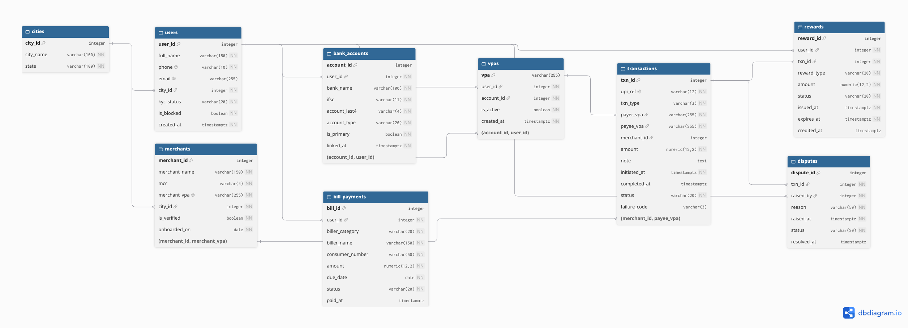
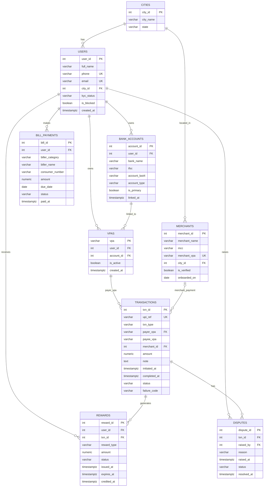

# 2. Schema Design

## 2.1 Database Overview

The database is designed to represent the core operations of a Google Pay UPI payment system. It manages users, their linked bank accounts, UPI Virtual Payment Addresses (VPAs), merchants, transactions, rewards, bill payments, and transaction disputes.

The database consists of nine tables:

1. `cities` – Stores city and state information.
2. `users` – Stores user details, contact information, and KYC status.
3. `bank_accounts` – Stores users' linked bank account details.
4. `vpas` – Stores UPI Virtual Payment Addresses associated with users and their bank accounts.
5. `merchants` – Stores merchant information and their registered UPI addresses.
6. `transactions` – Stores payment transaction details, including payer, payee, amount, status, and timestamps.
7. `rewards` – Stores rewards associated with users and transactions.
8. `bill_payments` – Stores bill payment details and payment status.
9. `disputes` – Stores disputes raised by users against transactions.

The database uses primary keys to uniquely identify records and foreign keys to maintain relationships between tables. Unique constraints prevent duplicate values in selected columns, while NOT NULL and CHECK constraints help maintain data validity and consistency.

All nine tables are created under the PostgreSQL schema named `gpay`.


## 2.2 Data Dictionary

### 2.2.1 Cities

The `cities` table stores the city and state information used by users and merchants.

| Column | Data Type | Constraint | Purpose |
|---|---|---|---|
| city_id | INTEGER | PRIMARY KEY | Uniquely identifies each city. |
| city_name | VARCHAR(100) | NOT NULL | Stores the name of the city. |
| state | VARCHAR(100) | NOT NULL | Stores the state in which the city is located. |

**Purpose:** This table avoids repeating city and state information in the `users` and `merchants` tables. Both tables reference `cities` through `city_id`.


### 2.2.2 Users

The `users` table stores user details, contact information, KYC status, and account status.

| Column | Data Type | Constraint | Purpose |
|---|---|---|---|
| user_id | INTEGER | PRIMARY KEY | Uniquely identifies each user. |
| full_name | VARCHAR(150) | NOT NULL | Stores the full name of the user. |
| phone | VARCHAR(10) | UNIQUE, NOT NULL, CHECK | Stores a unique 10-digit phone number. |
| email | VARCHAR(255) | UNIQUE, NULL allowed | Stores the user's email address. It is optional but must be unique when provided. |
| city_id | INTEGER | FOREIGN KEY, NOT NULL | References `cities.city_id` to identify the user's city. |
| kyc_status | VARCHAR(20) | NOT NULL, CHECK | Stores the user's KYC status: PENDING, VERIFIED, or REJECTED. |
| is_blocked | BOOLEAN | NOT NULL | Indicates whether the user's account is blocked. |
| created_at | TIMESTAMPTZ | NOT NULL | Stores the date and time when the user account was created. |

**Purpose:** This table maintains the registered users of the application. Each user belongs to one city and can have multiple linked bank accounts, VPAs, rewards, bill payments, and disputes.


### 2.2.3 Bank Accounts

The `bank_accounts` table stores the bank accounts linked by users to their Google Pay accounts.

| Column | Data Type | Constraint | Purpose |
|---|---|---|---|
| account_id | INTEGER | PRIMARY KEY | Uniquely identifies each bank account record. |
| user_id | INTEGER | FOREIGN KEY, NOT NULL | References `users.user_id` to identify the account owner. |
| bank_name | VARCHAR(100) | NOT NULL | Stores the name of the bank. |
| ifsc | VARCHAR(11) | NOT NULL, CHECK | Stores the bank branch IFSC code and validates its format. |
| account_last4 | VARCHAR(4) | NOT NULL, CHECK | Stores the last four digits of the bank account number. |
| account_type | VARCHAR(20) | NOT NULL, CHECK | Specifies whether the account is SAVINGS or CURRENT. |
| is_primary | BOOLEAN | NOT NULL | Indicates whether the bank account is the user's primary account. |
| linked_at | TIMESTAMPTZ | NOT NULL | Stores when the bank account was linked. |

**Additional constraint:** The combination of `(account_id, user_id)` is UNIQUE. This allows the `vpas` table to reference both columns together through a composite foreign key, ensuring that a VPA is linked to a bank account belonging to the same user.

**Purpose:** A user can link multiple bank accounts. Each bank account belongs to exactly one user.

### 2.2.4 VPAs

The `vpas` table stores the UPI IDs (Virtual Payment Addresses) associated with users and their linked bank accounts.

| Column | Data Type | Constraint | Purpose |
|---|---|---|---|
| vpa | VARCHAR(255) | PRIMARY KEY, CHECK | Uniquely identifies a VPA and validates its format. |
| user_id | INTEGER | FOREIGN KEY, NOT NULL | References `users.user_id` to identify the VPA owner. |
| account_id | INTEGER | FOREIGN KEY, NOT NULL | Identifies the bank account linked to the VPA. |
| is_active | BOOLEAN | NOT NULL | Indicates whether the VPA is currently active. |
| created_at | TIMESTAMPTZ | NOT NULL | Stores when the VPA was created. |

**Additional constraint:** The combination of `(account_id, user_id)` references the corresponding combination in `bank_accounts`. This composite foreign key ensures that the VPA is linked to a bank account belonging to the same user.

**Purpose:** A user can have multiple VPAs, and each VPA is associated with one user and one bank account.


### 2.2.5 Merchants

The `merchants` table stores details of businesses registered to receive payments through Google Pay.

| Column | Data Type | Constraint | Purpose |
|---|---|---|---|
| merchant_id | INTEGER | PRIMARY KEY | Uniquely identifies each merchant. |
| merchant_name | VARCHAR(150) | NOT NULL | Stores the merchant's business name. |
| mcc | VARCHAR(4) | NOT NULL, CHECK | Stores the four-digit Merchant Category Code. |
| merchant_vpa | VARCHAR(255) | UNIQUE, NOT NULL | Stores the merchant's unique UPI address. |
| city_id | INTEGER | FOREIGN KEY, NOT NULL | References `cities.city_id` to identify the merchant's city. |
| is_verified | BOOLEAN | NOT NULL | Indicates whether the merchant is verified. |
| onboarded_on | DATE | NOT NULL | Stores the date when the merchant joined the platform. |

**Additional constraint:** The combination of `(merchant_id, merchant_vpa)` is UNIQUE. It is referenced by the `transactions` table through a composite foreign key.

**Purpose:** This table maintains registered merchant information and allows merchant-related UPI transactions to be associated with the correct business.


### 2.2.6 Transactions

The `transactions` table stores all UPI payment transactions performed through the application. It includes payer and payee details, transaction amount, status, timestamps, and failure information.

| Column | Data Type | Constraint | Purpose |
|---|---|---|---|
| txn_id | INTEGER | PRIMARY KEY | Uniquely identifies each transaction. |
| upi_ref | VARCHAR(12) | UNIQUE, NOT NULL, CHECK | Stores the unique 12-digit UPI transaction reference. |
| txn_type | VARCHAR(3) | NOT NULL, CHECK | Specifies whether the transaction is P2P or P2M. |
| payer_vpa | VARCHAR(255) | FOREIGN KEY, NOT NULL | References `vpas.vpa` to identify the sender. |
| payee_vpa | VARCHAR(255) | NOT NULL | Stores the recipient's VPA. It is not independently a foreign key because P2P recipients may be external users. |
| merchant_id | INTEGER | FOREIGN KEY, NULL | Identifies the merchant for P2M transactions. It is NULL for P2P transactions. |
| amount | NUMERIC(12,2) | NOT NULL, CHECK | Stores the transaction amount, which must be greater than zero. |
| note | TEXT | NULL | Stores an optional payment description or note. |
| initiated_at | TIMESTAMPTZ | NOT NULL | Stores when the transaction was initiated. |
| completed_at | TIMESTAMPTZ | NULL | Stores when the transaction was completed. It remains NULL for pending transactions. |
| status | VARCHAR(20) | NOT NULL, CHECK | Stores the transaction status, such as SUCCESS, FAILED, PENDING, REFUNDED, or REVERSED. |
| failure_code | VARCHAR(3) | NULL, CHECK | Stores the failure code when a transaction fails. |

**Additional constraints and relationships:**

- The combination of `(merchant_id, payee_vpa)` references `(merchant_id, merchant_vpa)` in the `merchants` table through a composite foreign key.
- A P2P transaction must not have a `merchant_id`, while a P2M transaction must reference a merchant.
- The payer and payee VPAs cannot be identical.
- A failure code must be present for FAILED transactions and absent for other statuses.
- A PENDING transaction must have a NULL `completed_at`; other statuses must have a completion timestamp.
- If `completed_at` is provided, it cannot be earlier than `initiated_at`.

**Purpose:** This table acts as the central record of payments. It connects users' VPAs, merchants, rewards, and disputes while maintaining transaction details and payment status.


### 2.2.7 Rewards

The `rewards` table stores rewards issued to users based on their transactions. It maintains reward details, amounts, status, and relevant timestamps.

| Column | Data Type | Constraint | Purpose |
|---|---|---|---|
| reward_id | INTEGER | PRIMARY KEY | Uniquely identifies each reward. |
| user_id | INTEGER | FOREIGN KEY, NOT NULL | References `users.user_id` to identify the user receiving the reward. |
| txn_id | INTEGER | FOREIGN KEY, NOT NULL | References `transactions.txn_id` to identify the related transaction. |
| reward_type | VARCHAR(20) | NOT NULL, CHECK | Specifies the reward type: CASHBACK, COUPON, or SCRATCH_CARD. |
| amount | NUMERIC(12,2) | NOT NULL, CHECK | Stores the reward amount, which must be greater than or equal to zero. |
| status | VARCHAR(20) | NOT NULL, CHECK | Stores the reward status: CREDITED, EXPIRED, or UNSCRATCHED. |
| issued_at | TIMESTAMPTZ | NOT NULL | Stores when the reward was issued. |
| expires_at | TIMESTAMPTZ | NOT NULL | Stores when the reward expires. |
| credited_at | TIMESTAMPTZ | NULL | Stores when the reward was credited to the user. |

**Additional constraints:**

- `expires_at` cannot be earlier than `issued_at`.
- `credited_at`, when provided, cannot be earlier than `issued_at`.
- A CREDITED reward must have a `credited_at` timestamp.
- EXPIRED and UNSCRATCHED rewards must have a NULL `credited_at`.

**Purpose:** This table maintains reward information and connects each reward to both a user and the transaction associated with it.


### 2.2.8 Bill Payments

The `bill_payments` table stores bill payment records made by users through the application. It includes biller information, payment amounts, due dates, and payment status.

| Column | Data Type | Constraint | Purpose |
|---|---|---|---|
| bill_id | INTEGER | PRIMARY KEY | Uniquely identifies each bill payment record. |
| user_id | INTEGER | FOREIGN KEY, NOT NULL | References `users.user_id` to identify the user making the payment. |
| biller_category | VARCHAR(20) | NOT NULL, CHECK | Specifies the bill category, such as ELECTRICITY, MOBILE, GAS, WATER, BROADBAND, DTH, or FASTAG. |
| biller_name | VARCHAR(150) | NOT NULL | Stores the name of the biller or service provider. |
| consumer_number | VARCHAR(50) | NOT NULL | Stores the consumer or account number associated with the bill. |
| amount | NUMERIC(12,2) | NOT NULL, CHECK | Stores the bill amount, which must be greater than zero. |
| due_date | DATE | NOT NULL | Stores the date by which the bill should be paid. |
| status | VARCHAR(20) | NOT NULL, CHECK | Stores the bill status: DUE, OVERDUE, or PAID. |
| paid_at | TIMESTAMPTZ | NULL | Stores the date and time when the bill was paid. |

**Additional constraints:**

- A PAID bill must have a non-NULL `paid_at` timestamp.
- DUE and OVERDUE bills must have a NULL `paid_at` timestamp.

**Purpose:** This table maintains bill payment records for different services and connects each bill payment to the user who made it.


### 2.2.9 Disputes

The `disputes` table stores complaints raised by users regarding their UPI transactions. It maintains the reason for the dispute, the user who raised it, and its resolution status.

| Column | Data Type | Constraint | Purpose |
|---|---|---|---|
| dispute_id | INTEGER | PRIMARY KEY | Uniquely identifies each dispute. |
| txn_id | INTEGER | FOREIGN KEY, NOT NULL | References `transactions.txn_id` to identify the disputed transaction. |
| raised_by | INTEGER | FOREIGN KEY, NOT NULL | References `users.user_id` to identify the user who raised the dispute. |
| reason | VARCHAR(50) | NOT NULL, CHECK | Stores the reason for the dispute, such as FRAUD, DUPLICATE_PAYMENT, or WRONG_PAYEE. |
| raised_at | TIMESTAMPTZ | NOT NULL | Stores when the dispute was raised. |
| status | VARCHAR(20) | NOT NULL, CHECK | Stores the dispute status: OPEN, REJECTED, or RESOLVED. |
| resolved_at | TIMESTAMPTZ | NULL | Stores when the dispute was resolved or rejected. |

**Additional constraints:**

- An OPEN dispute must have a NULL `resolved_at` timestamp.
- REJECTED and RESOLVED disputes must have a non-NULL `resolved_at` timestamp.
- If `resolved_at` is provided, it cannot be earlier than `raised_at`.

**Purpose:** This table maintains transaction-related complaints and tracks their resolution. Each dispute is associated with one transaction and one user who raised it.


## 2.3 Relationships and Cardinalities

The database uses foreign key constraints to establish relationships between its nine tables. These relationships maintain referential integrity and connect related records across the database.

The following table describes all the relationships and their cardinalities.

| No. | Parent Table | Child Table | Relationship | Explanation |
|---|---|---|---|---|
| 1 | CITIES | USERS | 1:N | One city can have multiple users, but each user belongs to one city. |
| 2 | CITIES | MERCHANTS | 1:N | One city can have multiple merchants, but each merchant belongs to one city. |
| 3 | USERS | BANK_ACCOUNTS | 1:N | One user can link multiple bank accounts, but each bank account belongs to one user. |
| 4 | USERS | VPAS | 1:N | One user can have multiple VPAs, but each VPA belongs to one user. |
| 5 | BANK_ACCOUNTS | VPAS | 1:N | One bank account can be associated with multiple VPAs, but each VPA references one bank account. |
| 6 | VPAS | TRANSACTIONS | 1:N | One VPA can be used as the payer in multiple transactions, but each transaction has one payer VPA. |
| 7 | MERCHANTS | TRANSACTIONS | 1:N | One merchant can be associated with multiple transactions. A transaction may have zero or one merchant. |
| 8 | USERS | REWARDS | 1:N | One user can receive multiple rewards, but each reward references one user. |
| 9 | TRANSACTIONS | REWARDS | 1:N | One transaction can generate multiple rewards, but each reward references one transaction. |
| 10 | USERS | BILL_PAYMENTS | 1:N | One user can make multiple bill payments, but each bill payment belongs to one user. |
| 11 | TRANSACTIONS | DISPUTES | 1:N | One transaction can have multiple disputes, but each dispute references one transaction. |
| 12 | USERS | DISPUTES | 1:N | One user can raise multiple disputes, but each dispute is raised by one user. |

### Important Relationship Details

**1. Bank Accounts and VPAs**

The relationship between `bank_accounts` and `vpas` uses a composite foreign key consisting of `(account_id, user_id)`. This ensures that a VPA is linked to a bank account belonging to the same user.

**2. Merchants and Transactions**

The relationship uses a composite foreign key consisting of `(merchant_id, payee_vpa)`, referencing `(merchant_id, merchant_vpa)` in the `merchants` table.

This allows P2M transactions to be associated with the correct merchant. P2P transactions do not require a merchant, so `merchant_id` can be NULL.

**3. Payer and Payee VPAs**

The `payer_vpa` column references `vpas.vpa`. However, `payee_vpa` does not independently reference the `vpas` table because P2P payments can be made to external recipients who are not registered in the local database.

### Many-to-Many Relationships

The current schema does not contain a direct many-to-many relationship. The relationships are represented using foreign keys, including composite foreign keys where required.


## 2.4 Entity Relationship Diagram

The following ER diagram represents the nine tables in the Google Pay UPI database, along with their attributes, primary keys, foreign keys, and relationships.



### Mermaid ER Diagram Source



**Note:** The two composite foreign keys are documented in Sections 2.2 and 2.3. Mermaid's ER notation does not explicitly show the column pairs used by those composite constraints.


## 2.5 Functional Dependencies and Normalization

### 2.5.1 Functional Dependencies

A functional dependency describes a relationship in which one attribute or a set of attributes uniquely determines another attribute or set of attributes.

The following functional dependencies are identified from the database schema:

| Table | Functional Dependency |
|---|---|
| CITIES | city_id → city_name, state |
| USERS | user_id → full_name, phone, email, city_id, kyc_status, is_blocked, created_at |
| BANK_ACCOUNTS | account_id → user_id, bank_name, ifsc, account_last4, account_type, is_primary, linked_at |
| VPAS | vpa → user_id, account_id, is_active, created_at |
| MERCHANTS | merchant_id → merchant_name, mcc, merchant_vpa, city_id, is_verified, onboarded_on |
| TRANSACTIONS | txn_id → upi_ref, txn_type, payer_vpa, payee_vpa, merchant_id, amount, note, initiated_at, completed_at, status, failure_code |
| REWARDS | reward_id → user_id, txn_id, reward_type, amount, status, issued_at, expires_at, credited_at |
| BILL_PAYMENTS | bill_id → user_id, biller_category, biller_name, consumer_number, amount, due_date, status, paid_at |
| DISPUTES | dispute_id → txn_id, raised_by, reason, raised_at, status, resolved_at |

The schema also contains alternate unique identifiers, including `users.phone`, `users.email`, `merchants.merchant_vpa`, and `transactions.upi_ref`.


### 2.5.2 Normalization

The database schema is designed to reduce data redundancy and maintain data consistency. The tables are evaluated against the following normal forms.

**First Normal Form (1NF)**

All nine tables satisfy 1NF because:
- Each column contains atomic values.
- There are no repeating groups or multiple values stored in a single column.
- Each record can be uniquely identified using its primary key.

**Second Normal Form (2NF)**

All nine tables satisfy 2NF because:
- They satisfy 1NF.
- Every table has a single-column primary key.
- There are no partial dependencies on a part of a composite primary key.

**Third Normal Form (3NF)**

Most descriptive attributes are separated into their respective tables to reduce unnecessary repetition. For example, city information is stored in the `cities` table instead of being repeated in the `users` and `merchants` tables.

However, some attributes contain redundant information:

- In `vpas`, `account_id` identifies a bank account, which already determines its owner through `bank_accounts.user_id`. Therefore, storing `user_id` in `vpas` duplicates information. It is retained because the composite foreign key `(account_id, user_id)` ensures that a VPA cannot be linked to another user's bank account.
- In `rewards`, `user_id` can be derived through the associated transaction's `payer_vpa` and the corresponding VPA owner. It is retained for direct access to the reward recipient, and the dataset audit confirmed that the stored user matches the transaction payer.

These redundant attributes should be considered when evaluating strict 3NF compliance. They are retained to support the relationships and queries required by the project.

**Conclusion:** The schema is largely normalized, with a small number of intentionally retained redundant attributes. These are documented to make their effect on consistency and normalization clear.


## 2.6 Integrity Checks

Integrity checks were performed to verify that the database maintains valid relationships and consistent transaction information.

The following checks were executed on the loaded dataset.

### Check 1: P2P and P2M Merchant Consistency

This check verifies that P2M transactions have a merchant ID and P2P transactions do not have one.

```sql
SELECT COUNT(*) AS violations
FROM gpay.transactions
WHERE (txn_type = 'P2M' AND merchant_id IS NULL)
   OR (txn_type = 'P2P' AND merchant_id IS NOT NULL);
```

**Result:** 0 violations.

All transactions have the correct merchant association according to their transaction type.

### Check 2: Transaction Failure Code Consistency

This check verifies that FAILED transactions have a failure code and transactions with other statuses do not.

```sql
SELECT COUNT(*) AS violations
FROM gpay.transactions
WHERE (status = 'FAILED' AND failure_code IS NULL)
   OR (status <> 'FAILED' AND failure_code IS NOT NULL);
```

**Result:** 0 violations.

All transaction failure codes are consistent with their transaction statuses.

### Check 3: Transaction Completion Timestamp Consistency

This check verifies that PENDING transactions have a NULL completion timestamp and all other transaction statuses have a completion timestamp.

```sql
SELECT COUNT(*) AS violations
FROM gpay.transactions
WHERE (status = 'PENDING' AND completed_at IS NOT NULL)
   OR (status <> 'PENDING' AND completed_at IS NULL);
```

**Result:** 0 violations.

All transaction completion timestamps are consistent with their statuses.

### Check 4: VPA and Bank Account Ownership

This check verifies that every VPA is associated with a bank account belonging to the same user.

```sql
SELECT COUNT(*) AS violations
FROM gpay.vpas v
LEFT JOIN gpay.bank_accounts b
  ON v.account_id = b.account_id
 AND v.user_id = b.user_id
WHERE b.account_id IS NULL;
```
**Result:** 0 violations.

All VPAs are linked to bank accounts belonging to their respective users. This confirms that the VPA ownership matches the ownership of the associated bank account.

### Check 5: P2M Payee VPA and Merchant Consistency

This check verifies that the payee VPA of every P2M transaction matches the registered VPA of the associated merchant.

```sql
SELECT COUNT(*) AS violations
FROM gpay.transactions t
JOIN gpay.merchants m
  ON t.merchant_id = m.merchant_id
WHERE t.txn_type = 'P2M'
  AND t.payee_vpa <> m.merchant_vpa;
```
**Result:** 0 violations.

All P2M transactions use the registered VPA of their associated merchants. This confirms that the payee VPA matches the merchant's registered VPA.

### Check 6: Reward Recipient and Transaction Payer Consistency

This check verifies that the user receiving a reward is the same user who made the associated transaction.

```sql
SELECT COUNT(*) AS violations
FROM gpay.rewards r
JOIN gpay.transactions t
  ON r.txn_id = t.txn_id
JOIN gpay.vpas v
  ON t.payer_vpa = v.vpa
WHERE r.user_id <> v.user_id;
```
**Result:** 0 violations.

All rewards are associated with the same user who made the corresponding transaction. This confirms that the reward recipient matches the transaction payer.

### Summary of Integrity Check Results

| Check | Violations Found | Result |
|---|---:|---|
| P2P/P2M merchant consistency | 0 | Passed |
| Failure code consistency | 0 | Passed |
| Completion timestamp consistency | 0 | Passed |
| VPA and bank account ownership | 0 | Passed |
| P2M payee VPA and merchant consistency | 0 | Passed |
| Reward recipient and transaction payer consistency | 0 | Passed |

All six integrity checks passed with zero violations, indicating that the tested relationships and transaction rules are consistent in the loaded dataset.


## 2.7 Data Quality Issues

A data quality audit was performed on the dataset to identify missing values, duplicate records, invalid references, and inconsistencies.

### 2.7.1 Missing and NULL Values

The following NULL values were identified in the dataset:

| Table | Column | NULL Records | Explanation |
|---|---|---:|---|
| users | email | 15,950 | Email addresses are optional. |
| transactions | merchant_id | 110,581 | P2P transactions do not require a merchant. |
| transactions | note | 175,013 | Payment notes are optional. |
| transactions | completed_at | 125 | These records belong to pending transactions. |
| transactions | failure_code | 238,077 | Failure codes are only required for failed transactions. |
| rewards | credited_at | 8,054 | These rewards are expired or unscratched. |
| bill_payments | paid_at | 4,338 | These bills are due or overdue. |
| disputes | resolved_at | 116 | These disputes are still open. |

These NULL values are consistent with the intended database design and do not necessarily indicate data quality errors.

### 2.7.2 Duplicate Records

Duplicate checks were performed on the primary key columns and relevant unique identifiers.

No duplicate values were found in the audited primary keys and unique identifiers.

### 2.7.3 Referential Integrity

The foreign key relationships were checked against the referenced tables.

The following checks returned zero violations:

- User and city references.
- Bank account and user ownership.
- VPA and bank account ownership.
- P2M transaction and merchant association.
- Reward and transaction-user consistency.

### 2.7.4 External P2P Recipients

Some P2P transactions contain recipient VPAs that do not exist in the local `vpas` table.

During the audit:
- Total P2P transactions: 110,581.
- Recipient VPAs not found in the local VPA records: 16,583.

This is an expected characteristic because users can send money to people who are not registered in the local database. Therefore, `transactions.payee_vpa` is not defined as an independent foreign key referencing `vpas`.

### 2.7.5 Overall Audit Findings

The audit did not identify violations in the tested primary key, unique identifier, foreign key, and transaction consistency checks.

The identified NULL values and external P2P recipients are explained by the application's business requirements rather than being treated as invalid records.

## 2.8 NULL and Redundant Attribute Analysis

### 2.8.1 NULL Value Analysis

NULL values are allowed in certain columns because the corresponding information is optional or depends on the status of a record.

| Table | Column | Reason for Allowing NULL |
|---|---|---|
| users | email | A user can register without providing an email address. |
| transactions | merchant_id | P2P transactions do not involve a registered merchant. |
| transactions | note | Adding a payment note is optional. |
| transactions | completed_at | A pending transaction has not been completed yet. |
| transactions | failure_code | A failure code is only applicable to failed transactions. |
| rewards | credited_at | Expired and unscratched rewards have not been credited. |
| bill_payments | paid_at | Due and overdue bills have not been paid. |
| disputes | resolved_at | An open dispute has not yet been resolved or rejected. |

These NULL values represent valid business conditions and are not automatically considered missing or invalid data.

### 2.8.2 Redundant Attribute Analysis

Certain attributes are stored in multiple related tables. These attributes are retained to support the database design and maintain important relationships.

**1. rewards.user_id and transactions.payer_vpa**

The `rewards` table stores `user_id`, while the associated transaction already identifies the payer through `payer_vpa`.

Since the payer VPA belongs to a user, the reward recipient can also be identified through the transaction.

However, storing `user_id` directly in `rewards` makes it easier to identify the user receiving a reward. The dataset audit confirmed that the reward user matches the payer of the associated transaction.

**2. transactions.payee_vpa and merchants.merchant_vpa**

The `transactions` table stores `payee_vpa`, while the `merchants` table also stores `merchant_vpa`.

For P2M transactions, the payee VPA should match the merchant's registered VPA.

The composite foreign key `(merchant_id, payee_vpa)` referencing `(merchant_id, merchant_vpa)` ensures that these values correspond to the same merchant.

The `payee_vpa` column is also required for P2P transactions, where the recipient may not exist in the local database.

**3. vpas.user_id and bank_accounts.user_id**

Both the `vpas` and `bank_accounts` tables store `user_id`.

This is necessary to identify the owner of a VPA and the owner of its linked bank account.

The composite foreign key `(account_id, user_id)` in the `vpas` table ensures that the referenced bank account belongs to the same user as the VPA.

## 2.9 Business Rule Limitations

### 2.9.1 Refunds Restricted to P2M Transactions

The database allows transactions to have a `REFUNDED` status. However, the current schema does not enforce that refunds can only apply to P2M transactions.

This rule is not currently enforced through a CHECK constraint because it depends on the relationship between the transaction's status and its type. It would require additional database logic or application-level validation.

The following query can be used to identify any existing violations:

```sql
SELECT COUNT(*) AS violations
FROM gpay.transactions
WHERE status = 'REFUNDED'
  AND txn_type <> 'P2M';
```
**Result:** 0 violations.

All refunded transactions in the dataset are P2M transactions. However, this business rule is not enforced by the current database schema.

### 2.9.2 At Most One Primary Bank Account per User

The database is designed to allow each user to have at most one primary bank account. However, the current schema does not enforce this rule through a UNIQUE constraint.

The following query was used to identify users with more than one primary bank account:

```sql
SELECT COUNT(*) AS violations
FROM (
    SELECT user_id
    FROM gpay.bank_accounts
    WHERE is_primary = TRUE
    GROUP BY user_id
    HAVING COUNT(*) > 1
) AS primary_account_violations;
```

**Result:** 0 violations.

No user has more than one primary bank account in the loaded dataset. However, this rule is not enforced by the current database schema.

### 2.9.3 Daily UPI Transaction Limit

The daily UPI transaction limit considered in this project is ₹1,00,000 per user.

This limit applies to the total transaction amount made by a user in a day, rather than to an individual transaction. The current schema does not enforce this aggregate limit through a simple CHECK constraint because it requires calculating the total transaction amount for each user across multiple transaction records.

For this check, SUCCESS, REFUNDED, and REVERSED transactions are included in the daily transaction total. FAILED and PENDING transactions are excluded. This approach considers transactions that reached a completed payment state.

The following query was used to identify users whose daily transaction total exceeded the limit:

```sql
SELECT COUNT(*) AS violations
FROM (
    SELECT v.user_id, t.initiated_at::date AS txn_date
    FROM gpay.transactions t
    JOIN gpay.vpas v ON t.payer_vpa = v.vpa
    WHERE t.status IN ('SUCCESS', 'REFUNDED', 'REVERSED')
    GROUP BY v.user_id, t.initiated_at::date
    HAVING SUM(t.amount) > 100000
) AS daily_limit_violations;
```

**Result:** 0 violations.

No user exceeded the ₹1,00,000 daily transaction limit in the loaded dataset. However, this aggregate business rule is not enforced directly by the current database schema.

**Conclusion**

The dataset passed all three business-rule checks with zero violations. However, the current schema does not directly enforce these rules. Additional database logic or application-level validation would be required to enforce them consistently.